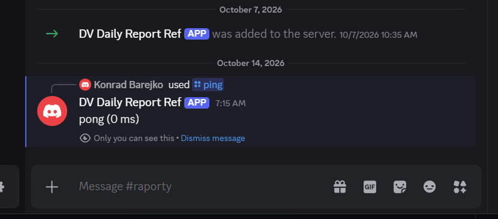

# #11 /ping command answers "pong"

## Green

```text
 Test Files  7 passed (7)
      Tests  25 passed (25)
```

## The whole route by hand, with a signed command

A one-off script: generate a key pair, put the public key in the
environment, sign a type 2 interaction for `ping`, call `POST`:

```text
200 {"type":4,"data":{"content":"pong (0 ms)","flags":64}}
```

The first attempt printed only `Node.js v24.16.0`: the one-off script had
`await` at the top of the file, which `tsx -e` compiles as CommonJS. The
same mistake as in #9, made again twenty minutes later, and pasted into this
journal before anyone read it. Fixed by wrapping the script in `main()`.

`type: 4` is CHANNEL_MESSAGE_WITH_SOURCE, `flags: 64` is "only the caller
sees it" (D8). The number of milliseconds is the time between receiving the
request and answering.

## Live on Discord 🇵🇱 Na żywo w Discordzie

On 2026-10-14 the mentor typed `/ping` in `#raporty` on **DV Interns' server**.
The deployed bot (`https://dv-bot-dev-reference.vercel.app`, #8) answered
`pong (0 ms)`, marked "Only you can see this" (D8). The 0 ms is expected: the
handler measures only its own work, not the trip from Discord.
🇵🇱 _14.10.2026 opiekun wpisał `/ping` na kanale `#raporty` na **DV Interns' server**. Bot z deployu (#8) odpowiedział `pong (0 ms)` z dopiskiem „Only you can see this” (D8). 0 ms jest w porządku: obsługa mierzy tylko własną pracę, nie drogę z Discorda._



This reference has one test server, so "both test servers" is checked on that
one. The interns check it on each other's servers.
🇵🇱 _Ten projekt ma jeden serwer testowy, więc punkt „oba serwery testowe” sprawdzony na nim. Praktykanci sprawdzają go na serwerach kolegi._

## What I learned 🇵🇱 Czego się nauczyłem

- A lookup table `{ ping, raport, … }` replaces a growing `if / else if`.
  Adding a command is one import and one line.
  🇵🇱 _Tablica `{ ping, raport, … }` zastępuje rosnące `if / else if`. Dodanie komendy to jeden import i jedna linia._
- The reply text is Polish on purpose (`Nie znam komendy /…`): the users are
  Polish. Code, commits and comments stay English.
  🇵🇱 _Tekst odpowiedzi jest celowo po polsku (`Nie znam komendy /…`): użytkownicy są polscy. Kod, commity i komentarze zostają po angielsku._
